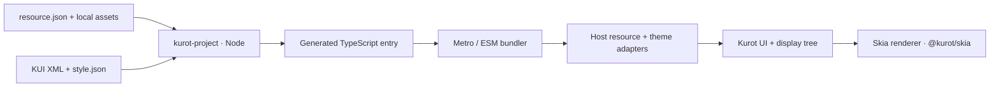

# Kurot Skia

`@kurot/skia` **0.1.2** — native Skia rendering adapters and resource/KUI entry generation for Kurot applications.

[简体中文](docs/README.zh-CN.md) · [Native runtime guide](docs/native-runtime.md) · [Library development](docs/development.md) · [Adaptation plan](docs/PLAN.md) · [Changelog](CHANGELOG.md)

Turn an existing `resource.json`, local assets and KUI XML skins into a static TypeScript entry that your bundler can resolve. The generator maintains the asset map, skin imports, factory registration and theme mapping for you, and updates them as you edit the project.

The package provides a React Native runtime, a Metro resolver helper, a Node CLI and a build-script API. The sibling `Kurot-Skia-Demo` uses the library renderer and keeps its scenes and project initialization. Applications can consume the npm release; use a local dependency when developing the library itself.

Version 0.1.2 replaces 0.1.1's custom nine-slice shader with native `drawImageNine` and cached atlas crops. The implementation passes the same 48 GPU cases and cache lifecycle checks on iOS 18.2 and 26.5 simulators, covering fractional transforms, atlas density/trim, smoothing and opacity. Crops copy source pixels on first use and retain the source alpha representation; subsequent draws reuse them.

**Migration from 0.1.1:** source frames and nine-slice boundaries must be integer physical pixels, with a positive center inside the frame. Logical half-pixel grids work at 2× density; arbitrary fractional physical splits now fail explicitly. Align those splits before upgrading, or keep 0.1.1 for that geometry. Package entries/APIs, resource/KUI formats and host requirements are unchanged. See [native validation and limits](docs/native-runtime.md#validation-and-limits) for cache lifetime, first-use copying and pending Android GPU/Release-device tests. This checkout prepares 0.1.2; use the npm commands below after publication.

For native rendering, follow the [native runtime guide](docs/native-runtime.md): install the package as a runtime dependency, configure `createKurotResolver()` from `@kurot/skia/metro`, and import `KurotView` from `@kurot/skia`. The instructions below describe resource/KUI generation; generator-only projects can use a development dependency.

## Install the generator

The generator requires Node.js >=20 and pnpm. Your application has its own platform requirements; the Demo's Expo SDK 57 requires Node.js >=22.13 ([Expo SDK reference](https://docs.expo.dev/versions/v57.0.0/)).

After 0.1.2 is published, install the generator in an existing Kurot project:

```sh
# In your application
pnpm add --save-dev '@kurot/skia@0.1.2'
```

For an Expo application, use [Expo's installer](https://docs.expo.dev/more/expo-cli/#install-dependencies) for that step:

```sh
pnpm exec expo install '@kurot/skia@0.1.2' --dev --pnpm
```

For native rendering, omit `--dev` so the library is a runtime dependency, then follow the [native runtime guide](docs/native-runtime.md). Applications using the npm package need no library checkout; use the installed resource-watch commands below.

The existing Demo uses npm `@kurot/skia@0.1.0`; its `pnpm dev --ios` or `pnpm dev --android` watches project resources and starts Expo. To test unpublished library changes, use an application installation explicitly declaring a local `file:` dependency and run the library's development supervisor. An existing native development build is required. See [library development](docs/development.md) for setup, synchronization and cleanup.

After publication, adopt the native implementation with `pnpm exec expo install '@kurot/skia@0.1.2' --pnpm`, then restart Metro with `--clear`. An existing development build containing Skia 3.3.0 can be reused because this patch changes JavaScript adapters only. Core 2.5.3, UI 3.5.0 and Skia 3.3.0 requirements stay the same. Resource/KUI formats and generated entries do not change; review the source-pixel grid requirement above before updating authored grids. Exact 0.1.0/0.1.1 dependencies need an explicit update, while compatible 0.1.x ranges can adopt through installation/lockfile updates. Generator-only projects can adopt separately without a native migration.

## Generate your project entry

A typical input tree is:

```text
resource/
├── resource.json
├── assets/
│   ├── logo.png
│   └── ui/
│       ├── ui.json
│       └── ui.png
├── config/
│   └── style.json             # optional project styles
└── ui/
    └── ButtonSkin.kui.xml
```

Keep your existing resource format. For example, a standalone image entry is:

```json
{
  "resources": [
    { "name": "logo", "type": "image", "url": "assets/logo.png" }
  ],
  "groups": [
    { "name": "preload", "keys": "logo" }
  ]
}
```

URLs are relative to the manifest directory. A sheet or bitmap-font descriptor resolves its image relative to its own file. Add resources to the manifest as usual; the generator follows those declarations and scans every `.kui.xml` under the skin directory.

Generate once from the application directory:

```sh
pnpm exec kurot-project --project .
```

Defaults are `resource/resource.json`, skins under `resource/`, optional styles at `resource/config/style.json`, and output under `src/generated/kurot/`. The resource and style defaults follow the manifest directory if you select a different manifest.

For a Kurot CLI game using `default.res.json`:

```sh
pnpm exec kurot-project --project . \
  --manifest resource/default.res.json \
  --skins resource/ui \
  --output src/generated/kurot
```

## Develop with watch

Watch without launching another program:

```sh
pnpm exec kurot-project --project . --watch
```

Or run the generator and your development server together:

```sh
pnpm exec kurot-project --project . --watch -- expo start --dev-client
```

Add these scripts to an Expo application's `package.json`:

```json
{
  "scripts": {
    "generate:project": "kurot-project --project .",
    "watch:project": "kurot-project --project . --watch",
    "start": "kurot-project --project . --watch -- expo start",
    "android": "kurot-project --project . --watch -- expo run:android",
    "ios": "kurot-project --project . --watch -- expo run:ios"
  }
}
```

`pnpm start --dev-client` now generates the entry and starts Expo. Saving the manifest, an image, a sheet descriptor, text, KUI or project styles regenerates it automatically. Skin additions, moves and removals update imports, registration and theme output. Referenced local assets outside the resource directory are watched too.

The watcher waits briefly for writes to settle, coalesces rapid saves and serializes generation. Invalid saves report an error and retain the last successful output; fixing the input resumes generation. Generated files and staging directories are excluded from watching.

The command after `--` starts in the project directory after the first successful generation, inherits the terminal/environment and stays running through subsequent saves. Its exit closes the watcher and forwards its exit code. Ctrl+C or SIGTERM closes the watcher and stops the command. Running Expo directly requires a separate watcher terminal.

## Use the generated entry

The generator creates:

| Output | Purpose |
| --- | --- |
| `assets.ts` | `bundledAssets`, `resourceConfigURL`, `resourceRoot` and `remoteURLs` |
| `skins/**/*.ts` | One compiled factory per KUI file, preserving its relative path |
| `skins.ts` | Static skin imports, `skinFactories`, `theme`, `themeConfigURL` and `registerSkinFactories()` |
| `theme.json` | Generated component-to-skin mapping and skin module reference |
| `index.ts` | Combined resource and skin exports |
| `.kurot-project.json` | Generator ownership and output file list |

Import this generated application entry in runtime code:

```ts
import {
    bundledAssets, resourceConfigURL, resourceRoot,
    skinFactories, theme, themeConfigURL, registerSkinFactories,
} from './generated/kurot';
```

Connect these values to your host adapters:

1. Register `bundledAssets` with the host's resource loader. JSON/text entries contain values; image/file entries contain bundler references. The loader must translate these entries into the platform's text and image loading contracts.
2. Use `resourceConfigURL` and `resourceRoot` with Kurot's `Resource.loadConfig()` after installing that loader. Resource names, groups and subkeys remain the project's own.
3. Call `registerSkinFactories()` and retain its returned restoration callback. It registers full skin class names on `globalThis` by default, or on a supplied `Record<string, unknown>`. `skinFactories` also supports a host that uses its own factory lookup.
4. Provide `theme` through the host's theme adapter and use `themeConfigURL` as its logical configuration URL. A static module loader can register the factories when `theme.skinsJs` is requested. Restore registrations when the host session is disposed.

The Demo implements these connections in `src/resources/bundled.ts` and `src/ui/native-ui.ts`, using runtime adapters from `@kurot/skia`. Creating a new native application requires the Metro configuration and canvas setup in the native guide. Generated modules alone do not start the engine.

Skin modules import `@kurot/core` and `@kurot/ui`; the host supplies those packages. The Demo's tested baseline is Core 2.5.3 and UI 3.5.0. Core/UI are optional host peers for the package runtime; the Node generator does not load them.

### Theme mapping

A skin whose final class-name segment equals a built-in component's name plus `Skin` supplies that component's default skin. For example, `skins.ButtonSkin` maps `Button` to that factory. Other skins are compiled and registered by their full class names for explicit `skinName` use.

Use a JSON map when choosing among defaults or mapping a custom host key:

```json
{ "Button": "alternate.ButtonSkin" }
```

```sh
pnpm exec kurot-project --project . --theme-map config/theme-map.json --watch
```

Every mapped class must exist in the scanned KUI files. Duplicate full class names and ambiguous default skins are errors. The map is read again on every generation.

## How it works



The generator validates resource declarations, collects their local dependencies, and compiles all KUI using the pinned Kurot CLI compiler. Project styles resolve Label presets and color references during compilation. Authored manifests, names, groups, object subkeys, XML, nine-slice grids and sheet resolution are preserved.

JSON and text are embedded in TypeScript. Images and audio become static references: `--assets metro` emits literal `require(...)` calls and extensionless skin imports; `--assets url` emits `new URL(..., import.meta.url).href` and `.js` skin imports. Your bundler must support the chosen mode and compile the generated TypeScript. Neither mode copies the source assets.

All inputs must validate and compile before an owned output directory is replaced. Removed skins leave no stale factories. Missing resources, invalid KUI or unrecognized files in the output stop generation and preserve the previous result. Keep authored code out of the generated directory.

The phone consumes bundled code and assets, so it does not need to parse KUI XML or discover a theme's modules dynamically at runtime. Runtime resource caching, image decoding, theme application and rendering remain the host's responsibility.

## CLI reference

| Option | Default / meaning |
| --- | --- |
| `--project <dir>` | Current directory; project root |
| `--manifest <file>` | `resource/resource.json` |
| `--skins <dir>` | Manifest directory; recursively scan `.kui.xml` |
| `--style <file>` | `<manifest directory>/config/style.json`; optional unless explicitly supplied |
| `--output <dir>` | `src/generated/kurot` |
| `--assets metro\|url` | `metro`; generated asset-reference and import mode |
| `--theme-map <file>` | Optional JSON object of host keys to skin class names |
| `--watch`, `-w` | Generate initially and keep watching |
| `--help`, `-h` | Show command usage |

Manifest, skin, style and output paths are relative to `--project` and must stay inside that project. `--theme-map` is relative to the command's working directory. Paths may be absolute where they satisfy the same constraints. `-- <command> <args...>` is available only with `--watch`.

## Build-script API

Import the Node-only API from `@kurot/skia/generator` in build scripts. Runtime applications import the generated files instead.

```ts
import { generateProject } from '@kurot/skia/generator';

const result = await generateProject({
    projectRoot: '/path/to/game',
    manifest: 'resource/resource.json',
    outputDir: 'src/generated/kurot',
    assetMode: 'metro',
});
console.info(result.outputDir, result.assets, result.skins);
```

`ProjectOptions` also accepts `skinsDir`, `styleSheet` and either `themeSkins` (a host-to-class map) or `themeMapFile` (a JSON file). API paths are relative to `projectRoot`, including `themeMapFile`. `ProjectResult` provides `outputDir`, `resourceConfigURL`, `assets`, `remoteURLs`, `skins` and `files`; asset URLs are project-relative logical URLs, and output file paths are relative to the output directory.

For a long-running build script:

```ts
import { watchProject } from '@kurot/skia/generator';

const stopped = new Promise<void>(resolve => {
    process.once('SIGINT', resolve);
    process.once('SIGTERM', resolve);
});
const watcher = await watchProject({ projectRoot: '/path/to/game' }, {
    debounceMs: 100,
    onGenerated: result => console.info(result.outputDir),
    onError: error => console.error(error.message),
});
await stopped;
await watcher.close();
```

`watchProject()` performs an initial generation and returns a `ProjectWatcher`. Generation errors invoke `onError` and keep watching, including an invalid initial input. `onGenerated` runs after successful generation. `close()` is idempotent, cancels scheduled work and waits for an active generation. The API caller owns signal handling and any development-server process; the CLI handles those for you.

## Supported inputs and limits

The generator recognizes `image`, `sheet`, `json`, `text`, `font` and `sound`. Here, `font` means a bitmap-font descriptor and its image page. Sound is emitted as a `file` entry. Local resource URLs must be plain paths without query strings, fragments or backslashes, and resolve inside the project. Symlinks and special files in scanned skin directories are rejected.

Remote URLs are retained for runtime loading. They are not downloaded or watched, and dependencies inside remote sheet/font descriptors are not discovered. Unknown resource types and unknown KUI component namespaces require explicit build-time support.

Resource generation does not provide platform rendering support for every resource type. The native runtime currently has no bitmap-font/audio rendering integration or bundled font registration; `style.json` is used for compilation. Its UI runtime validation focuses on Label and Button. Compiling additional skins does not establish native support for all their controls.

Compiler behavior comes from pinned `@kurot/cli` 3.6.0 and `@kurot/ui-document` 0.13.1. The compiler's internal import is isolated in `src/generator/compiler.ts`; validate it when updating CLI.

## Develop the library

```sh
pnpm build
pnpm test
```

Runtime adapters live in `src/kurot/`, the generator in `src/generator/`, Metro integration in `src/metro.cts`, and local development tools in `src/development/`. Tests cover generation, resource watch, Metro mapping, successful-build synchronization, module additions/removals, error recovery and cleanup. The former `/project` API is now `/generator`; update build-script imports and regenerate output created by the earlier local generator.

Native rendering also needs the Demo's device tests. Its GPU nine-slice regression reads a GPU-backed surface and checks fractional transforms, transparency, atlas density/trim and original KUI frames. See [native validation](docs/native-runtime.md#validation-and-limits); Node tests do not execute this suite.

Before publishing, run `pnpm test` and inspect the result of `pnpm pack`, then run `pnpm publish --access public`. The `prepack` hook cleans and rebuilds `dist`; `prepublishOnly` runs tests. The package ships the native runtime, Metro helper, generator, declarations and public documentation. A version number or local commit does not establish publication; verify registry availability before switching the Demo to the npm dependency.
