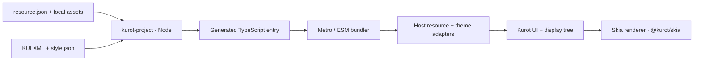

# Kurot Skia

`@kurot/skia` **0.2.0** — native Skia rendering adapters and resource/KUI entry generation for Kurot applications.

[简体中文](docs/README.zh-CN.md) · [Native runtime guide](docs/native-runtime.md) · [Library development](docs/development.md) · [Adaptation plan](docs/PLAN.md) · [Changelog](CHANGELOG.md)

Turn an existing `resource.json`, local assets and KUI XML skins into a static TypeScript entry that your bundler can resolve. The generator maintains the asset map, skin imports, factory registration and theme mapping for you, and updates them as you edit the project.

The package provides a React Native runtime, a Metro resolver helper, a Node CLI and a build-script API. The sibling `Kurot-Skia-Demo` uses the library renderer and keeps its scenes and project initialization. Applications can consume the npm release; use a local dependency when developing the library itself.

[Version 0.2.0 is on npm](https://www.npmjs.com/package/@kurot/skia/v/0.2.0). It targets Core 3.2, UI 5.1, CLI 5 and Expo SDK 58. The [Expo Demo](https://github.com/kurot-engine/kurot-skia-demo) installs this registry release.

Version 0.1.3 adds native Mesh, Game/Spine/DragonBones rendering, broader UI/text/input support and an opt-in shared Spine animation cache. It retains 0.1.2's native `drawImageNine` and cached atlas crops. The same 48 GPU cases pass on iOS 18.2/26.5 and Android API 36 simulations, covering fractional transforms, atlas density/trim, smoothing and opacity. Crops copy source pixels on first use and retain the source alpha representation; subsequent draws reuse them.

**Migration:** upgrading from 0.1.2–0.1.5 preserves source geometry, package entries, resource/KUI formats; the native host must be upgraded. From 0.1.1 or earlier, source frames and nine-slice boundaries must be integer physical pixels, with a positive center inside the frame. Logical half-pixel grids work at 2× density; align arbitrary fractional physical splits before upgrading. See [native validation and limits](docs/native-runtime.md#validation-and-limits) for cache lifetime, first-use copying and remaining device tests.

For native rendering, follow the [native runtime guide](docs/native-runtime.md): install the package as a runtime dependency, configure `createKurotResolver()` from `@kurot/skia/metro`, and import `KurotView` from `@kurot/skia`. The instructions below describe resource/KUI generation; generator-only projects can use a development dependency.

## Native features

Version 0.1.5 adds an opt-in `NativePictureCache` for static
subtrees. Instantiate it with a display object, call `invalidate()` after direct
mutable-data edits and `dispose()` to disable/release it. Root movement/rotation/
scale normally reuse commands; external mask relationships, content, effective alpha/tint, fonts and resource changes
re-record. It preserves ordinary per-child opacity. See [Picture caching](docs/native-runtime.md#picture-caching)
for ownership, limits and comparison measurements. npm 0.1.4 does not include it.

The runtime implements native bitmap fill/tint/rotation and ordinary sprite batches, Mesh, BitmapText, particle batches,
compositing, built-in filters, cacheAsTexture, RenderTexture, gradients/dashes,
bundled fonts and the RN TextInput bridge. Published Game, Spine 4.0–4.3 and DragonBones run
through the shared native primitives; original UI skins remain compiled by CLI.
Use the npm package for these features; use an explicit local `file:` installation only for library source development.

Version 0.1.4 separates the native host, frame loop, Graphite recording and
primitive resources into internal modules. Keep `createScene` stable; changing `onStats` or
`onError` updates notifications without recreating the scene. See the
[rendering responsibilities](docs/native-runtime.md#internal-rendering-responsibilities).

See the [feature assessment](docs/native-feature-assessment.md) for exact coverage,
measured scene limits and remaining work. The independent test host under
`tests/native/app` exercises real GPU pixels and includes a UI gallery and
performance fixtures. `pnpm test` runs Node tooling tests, not native JSI tests.
Release simulator results use the 60 FPS / 16.67 ms diagnostic budget; heavy
scenes still exceed it. [iOS keyboard checks](docs/native-input-acceptance.md)
record actual Pinyin, password and selection behavior. Phone performance and
Android actual IME remain unverified.
Ordered Mesh batches and exact-content native buffer sharing reduce Spine
recording overhead while retaining independent animation updates. See the
[Spine optimization report](docs/native-spine-optimization.md) for before/after
Release measurements and the additional different-phase scene.
Existing benchmark reports describe their recorded SDK and native versions.
An optional [shared Spine animation cache](docs/native-spine-shared-cache.md)
bakes one looping action/skin and shares immutable poses/native geometry among
independently phased actors. It samples at 60 Hz by default; live skeleton edits,
mixing and timeline events stay on the original SDK path. For 20 different-phase
Spineboy actors, cached p95 measures 7.37–10.14 ms across the three Release
simulation environments, versus 16.35–21.84 ms on the live path. See the cache
guide for sampling, loading costs and the limits of this diagnostic comparison.

The [native Spine backend assessment](docs/native-spine-backend-assessment.md)
evaluates C++ computation, API compatibility and a possible 120 FPS path;
this backend is not implemented.

## Install the generator

Use Node.js 22.22 or newer on the 22 LTS line and pnpm. Other supported Node lines are listed in the package engines field. The native test app uses Expo SDK 58.

Install the generator in an existing Kurot project:

```sh
# In your application
pnpm add --save-dev '@kurot/skia@^0.2.0'
```

For an Expo application, use [Expo's installer](https://docs.expo.dev/more/expo-cli/#install-dependencies) for that step:

```sh
pnpm exec expo install '@kurot/skia@^0.2.0' --dev --pnpm
```

For native rendering, omit `--dev` so the library is a runtime dependency, then follow the [native runtime guide](docs/native-runtime.md). Applications using the npm package need no library checkout; use the installed resource-watch commands below.

The Demo consumes npm `@kurot/skia@0.2.0`. Its `pnpm dev --ios` or `pnpm dev --android` watches project resources and starts Expo. To test unpublished library changes, use an application installation explicitly declaring a local `file:` dependency and run the library's development supervisor. An existing native development build is required. See [library development](docs/development.md) for setup, synchronization and cleanup.

To migrate from 0.1.x, install the 0.2 series, regenerate entries, rebuild the native client and restart Metro with `--clear`. The [native guide](docs/native-runtime.md#install-in-an-application) lists the supported host ranges and the React renderer exception. A client built for 0.1.x cannot load the new Skia native module.

Native pixel reads are asynchronous: use `NativeRenderTexture.readPixel32()`, `hitTestNative()`, and [prepare manually created atlases](docs/native-runtime.md#migrating-native-pixel-apis-to-02) before drawing subframes.

## Generate your project entry

A typical input tree is:

```text
resource/
├── resource.json
├── assets/
│   ├── logo.png
│   └── ui/
│       ├── ui.json
│       └── ui.png
├── config/
│   └── style.json             # optional project styles
└── ui/
    └── ButtonSkin.kui.xml
```

Keep your existing resource format. For example, a standalone image entry is:

```json
{
  "resources": [
    { "name": "logo", "type": "image", "url": "assets/logo.png" }
  ],
  "groups": [
    { "name": "preload", "keys": "logo" }
  ]
}
```

URLs are relative to the manifest directory. A sheet or bitmap-font descriptor resolves its image relative to its own file. Add resources to the manifest as usual; the generator follows those declarations and scans every `.kui.xml` under the skin directory.

Generate once from the application directory:

```sh
pnpm exec kurot-project --project .
```

Defaults are `resource/resource.json`, skins under `resource/`, optional styles at `resource/config/style.json`, and output under `src/generated/kurot/`. The resource and style defaults follow the manifest directory if you select a different manifest.

For a Kurot CLI game using `default.res.json`:

```sh
pnpm exec kurot-project --project . \
  --manifest resource/default.res.json \
  --skins resource/ui \
  --output src/generated/kurot
```

## Develop with watch

Watch without launching another program:

```sh
pnpm exec kurot-project --project . --watch
```

Or run the generator and your development server together:

```sh
pnpm exec kurot-project --project . --watch -- expo start --dev-client
```

Add these scripts to an Expo application's `package.json`:

```json
{
  "scripts": {
    "generate:project": "kurot-project --project .",
    "watch:project": "kurot-project --project . --watch",
    "start": "kurot-project --project . --watch -- expo start",
    "android": "kurot-project --project . --watch -- expo run:android",
    "ios": "kurot-project --project . --watch -- expo run:ios"
  }
}
```

`pnpm start --dev-client` now generates the entry and starts Expo. Saving the manifest, an image, a sheet descriptor, text, KUI or project styles regenerates it automatically. Skin additions, moves and removals update imports, registration and theme output. Referenced local assets outside the resource directory are watched too.

The watcher waits briefly for writes to settle, coalesces rapid saves and serializes generation. Invalid saves report an error and retain the last successful output; fixing the input resumes generation. Generated files and staging directories are excluded from watching.

The command after `--` starts in the project directory after the first successful generation, inherits the terminal/environment and stays running through subsequent saves. Its exit closes the watcher and forwards its exit code. Ctrl+C or SIGTERM closes the watcher and stops the command. Running Expo directly requires a separate watcher terminal.

## Use the generated entry

The generator creates:

| Output | Purpose |
| --- | --- |
| `assets.ts` | `bundledAssets`, `resourceConfigURL`, `resourceRoot` and `remoteURLs` |
| `skins/**/*.ts` | One compiled factory per KUI file, preserving its relative path |
| `skins.ts` | Static skin imports, `skinFactories`, `theme`, `themeConfigURL` and `registerSkinFactories()` |
| `theme.json` | Generated component-to-skin mapping and skin module reference |
| `index.ts` | Combined resource and skin exports |
| `.kurot-project.json` | Generator ownership and output file list |

Import this generated application entry in runtime code:

```ts
import {
    bundledAssets, resourceConfigURL, resourceRoot,
    skinFactories, theme, themeConfigURL, registerSkinFactories,
} from './generated/kurot';
```

Connect these values to your host adapters:

1. Register `bundledAssets` with the host's resource loader. JSON/text entries contain values; image/file entries contain bundler references. The loader must translate these entries into the platform's text and image loading contracts.
2. Use `resourceConfigURL` and `resourceRoot` with Kurot's `Resource.loadConfig()` after installing that loader. Resource names, groups and subkeys remain the project's own.
3. Call `registerSkinFactories()` and retain its returned restoration callback. It registers full skin class names on `globalThis` by default, or on a supplied `Record<string, unknown>`. `skinFactories` also supports a host that uses its own factory lookup.
4. Provide `theme` through the host's theme adapter and use `themeConfigURL` as its logical configuration URL. A static module loader can register the factories when `theme.skinsJs` is requested. Restore registrations when the host session is disposed.

The Demo implements these connections in `src/resources/bundled.ts` and `src/ui/native-ui.ts`, using runtime adapters from `@kurot/skia`. Creating a new native application requires the Metro configuration and canvas setup in the native guide. Generated modules alone do not start the engine.

Skin modules import `@kurot/core` and `@kurot/ui`; the host supplies those packages. The private test host locks Core 3.2.3 and UI 5.1.2. Core/UI are optional host peers for the package runtime; the Node generator does not load them.

### Theme mapping

A skin whose final class-name segment equals a built-in component's name plus `Skin` supplies that component's default skin. For example, `skins.ButtonSkin` maps `Button` to that factory. Other skins are compiled and registered by their full class names for explicit `skinName` use.

Use a JSON map when choosing among defaults or mapping a custom host key:

```json
{ "Button": "alternate.ButtonSkin" }
```

```sh
pnpm exec kurot-project --project . --theme-map config/theme-map.json --watch
```

Every mapped class must exist in the scanned KUI files. Duplicate full class names and ambiguous default skins are errors. The map is read again on every generation.

## How it works



The generator validates resource declarations, collects their local dependencies, and compiles all KUI using the pinned Kurot CLI compiler. Project styles resolve Label presets and color references during compilation. Authored manifests, names, groups, object subkeys, XML, nine-slice grids and sheet resolution are preserved.

JSON and text are embedded in TypeScript. Images and audio become static references: `--assets metro` emits literal `require(...)` calls and extensionless skin imports; `--assets url` emits `new URL(..., import.meta.url).href` and `.js` skin imports. Your bundler must support the chosen mode and compile the generated TypeScript. Neither mode copies the source assets.

All inputs must validate and compile before an owned output directory is replaced. Removed skins leave no stale factories. Missing resources, invalid KUI or unrecognized files in the output stop generation and preserve the previous result. Keep authored code out of the generated directory.

The phone consumes bundled code and assets, so it does not need to parse KUI XML or discover a theme's modules dynamically at runtime. Runtime resource caching, image decoding, theme application and rendering remain the host's responsibility.

## CLI reference

| Option | Default / meaning |
| --- | --- |
| `--project <dir>` | Current directory; project root |
| `--manifest <file>` | `resource/resource.json` |
| `--skins <dir>` | Manifest directory; recursively scan `.kui.xml` |
| `--style <file>` | `<manifest directory>/config/style.json`; optional unless explicitly supplied |
| `--output <dir>` | `src/generated/kurot` |
| `--assets metro\|url` | `metro`; generated asset-reference and import mode |
| `--theme-map <file>` | Optional JSON object of host keys to skin class names |
| `--watch`, `-w` | Generate initially and keep watching |
| `--help`, `-h` | Show command usage |

Manifest, skin, style and output paths are relative to `--project` and must stay inside that project. `--theme-map` is relative to the command's working directory. Paths may be absolute where they satisfy the same constraints. `-- <command> <args...>` is available only with `--watch`.

## Build-script API

Import the Node-only API from `@kurot/skia/generator` in build scripts. Runtime applications import the generated files instead.

```ts
import { generateProject } from '@kurot/skia/generator';

const result = await generateProject({
    projectRoot: '/path/to/game',
    manifest: 'resource/resource.json',
    outputDir: 'src/generated/kurot',
    assetMode: 'metro',
});
console.info(result.outputDir, result.assets, result.skins);
```

`ProjectOptions` also accepts `skinsDir`, `styleSheet` and either `themeSkins` (a host-to-class map) or `themeMapFile` (a JSON file). API paths are relative to `projectRoot`, including `themeMapFile`. `ProjectResult` provides `outputDir`, `resourceConfigURL`, `assets`, `remoteURLs`, `skins` and `files`; asset URLs are project-relative logical URLs, and output file paths are relative to the output directory.

For a long-running build script:

```ts
import { watchProject } from '@kurot/skia/generator';

const stopped = new Promise<void>(resolve => {
    process.once('SIGINT', resolve);
    process.once('SIGTERM', resolve);
});
const watcher = await watchProject({ projectRoot: '/path/to/game' }, {
    debounceMs: 100,
    onGenerated: result => console.info(result.outputDir),
    onError: error => console.error(error.message),
});
await stopped;
await watcher.close();
```

`watchProject()` performs an initial generation and returns a `ProjectWatcher`. Generation errors invoke `onError` and keep watching, including an invalid initial input. `onGenerated` runs after successful generation. `close()` is idempotent, cancels scheduled work and waits for an active generation. The API caller owns signal handling and any development-server process; the CLI handles those for you.

## Supported inputs and limits

The generator recognizes `image`, `sheet`, `json`, `text`, `font` and `sound`. Here, `font` means a bitmap-font descriptor and its image page. Sound becomes a `file` entry. Declare binary skeletons/typefaces as `text` resources with `.skel`, `.dbbin`, `.bin`, `.ttf`, `.otf` or `.woff`/`.woff2` extensions: the generator embeds their bytes losslessly as binary entries. Local Spine `.atlas` text entries also collect their image pages. Local resource URLs must be plain paths without query strings, fragments or backslashes, and resolve inside the project. Symlinks and special files in scanned skin directories are rejected.

Remote URLs are retained for runtime loading. They are not downloaded or watched, and dependencies inside remote sheet/font descriptors are not discovered. Unknown resource types and unknown KUI component namespaces require explicit build-time support.

Resource generation does not provide every platform capability. Version 0.1.3 includes bitmap-font rendering, explicit bundled-font registration, broader UI regression and an optional audio contract; actual media playback still needs a project-owned backend. `style.json` compilation does not initialize project fonts automatically. Consult the [current assessment](docs/native-feature-assessment.md) before relying on a particular control or resource type.

Compiler behavior comes from `@kurot/cli` ~5.0.0 and `@kurot/ui-document` ^0.14.0. The compiler's internal import is isolated in `src/generator/compiler.ts`; validate it when updating CLI.

## Develop the library

```sh
pnpm build
pnpm test
```

Runtime adapters live in `src/kurot/`, the generator in `src/generator/`, Metro integration in `src/metro.cts`, and local development tools in `src/development/`. Tests cover generation, resource watch, Metro mapping, successful-build synchronization, module additions/removals, error recovery and cleanup. The former `/project` API is now `/generator`; update build-script imports and regenerate output created by the earlier local generator.

Version 0.1.5 groups runtime source modules for view/frame lifecycle, rendering,
cache ownership, text/fonts, input, resources and Spine into their own folders.
`src/kurot/index.ts` remains the public runtime entry. See the
[source layout](docs/native-runtime.md#runtime-source-layout) for responsibilities.

Native rendering also needs the isolated `tests/native/app` host for unpublished changes. It retains the Demo's unmodified GPU nine-slice oracles and adds Game, Spine, DragonBones, UI, resources and lifecycle checks plus performance diagnostics. See [the test instructions](https://github.com/kurot-engine/kurot-skia/tree/main/tests/native) and [recorded acceptance](docs/native-feature-assessment.md); Node tests do not execute native JSI.

Before publishing, run `pnpm test` and inspect the result of `pnpm pack`, then run `pnpm publish --access public`. The `prepack` hook cleans and rebuilds `dist`; `prepublishOnly` runs tests. The package ships the native runtime, Metro helper, generator, declarations and public documentation. A version number or local commit does not establish publication; verify registry availability before switching the Demo to the npm dependency.
