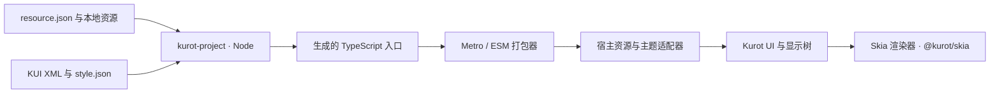

# Kurot Skia

`@kurot/skia` **0.1.4** — Kurot 的原生 Skia 渲染适配与资源/KUI 入口生成工具。

[English](../README.md) · [原生运行时指南](native-runtime.md) · [库开发指南](development.md) · [适配与测试计划](PLAN.md) · [变更记录](../CHANGELOG.md)

将已有的 `resource.json`、本地资源和 KUI XML 皮肤转换成打包器可识别的静态 TypeScript 入口。生成器自动维护资源表、皮肤导入、工厂注册和主题映射，并在编辑项目时同步更新。

本包提供 React Native 运行时、Metro resolver、Node CLI 和构建脚本 API。相邻的 `Kurot-Skia-Demo` 已通过库使用渲染适配，并保留场景与项目初始化。应用可以使用 npm 发布包，开发库本身时使用本地依赖。

0.1.4 已发布，包含内部渲染组织调整和保留场景的通知回调更新；2026-10-11 已验证注册表包，Demo 安装精确的 npm 0.1.4。

0.1.3 增加原生 Mesh、Game/Spine/DragonBones 绘制、更完整的 UI/文字/输入支持和可选的共享 Spine 动画缓存。保留 0.1.2 的原生 `drawImageNine` 和缓存图集子图。同一组 48 项 GPU 用例在 iOS 18.2/26.5 和 Android API 36 模拟环境通过，覆盖分数变换、图集密度/trim、过滤和透明度。首次使用复制源像素并保留原图的 alpha 表示，后续绘制复用缓存。

**迁移：**从 0.1.2 或 0.1.3 升级无需修改源图几何、包入口、resource/KUI 格式或宿主版本。从 0.1.1 或更早版本升级时，源图区域和九宫格分割线必须落在整数物理像素上，中心区域需为正且位于帧内。2× 密度允许 0.5 的逻辑坐标；升级前需对齐任意小数物理分割线。缓存生命周期、首次复制成本及剩余真机测试见[原生验证与限制](native-runtime.md#validation-and-limits)。

接入原生渲染请先看[原生运行时指南](native-runtime.md)：把库放入运行时依赖，配置 `@kurot/skia/metro` 的 `createKurotResolver()`，再从 `@kurot/skia` 导入 `KurotView`。下文主要介绍资源/KUI 生成；只使用生成器的项目可以放入开发依赖。

## 原生特性

工作树新增**尚未发布**的可选 `NativePictureCache`：用显示对象创建缓存句柄，直接修改可变绘制数据后调用 `invalidate()`，结束使用时调用 `dispose()` 关闭并释放。根节点移动、旋转和缩放通常复用命令；外部遮罩关系、内容、有效 alpha/tint、字体及资源变化触发重录，保留普通绘制的子项透明度合成。所有权、预算和对比测量见 [Picture 缓存](native-runtime.md#picture-caching-unreleased)。npm 0.1.4 不包含此功能。

0.1.4 将原生宿主、帧循环、Graphite 录制和图元资源拆分为各自管理职责的内部模块。保持 `createScene` 稳定；更新 `onStats`、`onError` 会替换通知回调，保留已有场景实例。内部模块分工见[渲染职责](native-runtime.md#internal-rendering-responsibilities)。

运行时实现 Bitmap 填充/tint/旋转和普通精灵批绘制、Mesh、BitmapText、粒子批绘制、混合/遮罩/内置滤镜、cacheAsTexture、RenderTexture、渐变/虚线、打包字体和 RN TextInput 桥。发布版 Game、Spine 4.0–4.3、DragonBones 使用共享原生绘制能力，原版 UI 皮肤仍交给 CLI 编译。这些功能通过 npm 包提供；开发库源码时才需要明确使用本地 `file:` 安装。

[特性评估](native-feature-assessment.md) 记录完整覆盖、场景性能上限和待办。`tests/native/app` 是独立 GPU 测试宿主，含 UI gallery 和性能场景；`pnpm test` 只运行 Node 工具测试。Core/UI 源码、Web 工作流和 SDK 版本要求不变。

Release 模拟器按 60 FPS / 16.67 ms 预算诊断，重负载仍有超预算场景。[iOS 键盘验收](native-input-acceptance.md) 记录实际拼音、密码和选区操作；真机性能及 Android 实际 IME 尚未验证。

Mesh 按原始顺序合批，几何数据完全相同的角色共享原生顶点缓冲；每个角色仍独立更新动画。[Spine 优化报告](native-spine-optimization.md) 记录 Release 前后对比，并单独测试错开动画相位的场景。

新增可选的[共享 Spine 动画缓存](native-spine-shared-cache.md)：一个固定动作/皮肤预采样后，各角色独立相位，共享姿态与跨帧原生网格。默认按 60 Hz 采样，实时骨骼修改、动画混合和时间轴事件仍使用原 SDK 播放器。20 个错开相位的 Spineboy 在三个 Release 模拟环境中的缓存 p95 为 7.37–10.14 ms，实时模式为 16.35–21.84 ms。采样、加载成本和诊断对比限制见缓存指南。

[Spine 原生后端评估](native-spine-backend-assessment.md) 分析 C++ 计算下沉、API 兼容成本和 120 FPS 路径；该后端尚未实现。

## 安装生成器

生成器需要 Node.js >=20 和 pnpm。应用本身还有独立的平台要求；Demo 使用的 Expo SDK 57 需要 Node.js >=22.13（[Expo SDK 文档](https://docs.expo.dev/versions/v57.0.0/)）。

在现有 Kurot 应用中安装生成器：

```sh
# 在应用项目中
pnpm add --save-dev '@kurot/skia@0.1.4'
```

Expo 应用在这一步使用 [Expo 安装命令](https://docs.expo.dev/more/expo-cli/#install-dependencies)：

```sh
pnpm exec expo install '@kurot/skia@0.1.4' --dev --pnpm
```

接入原生渲染时去掉 `--dev`，将库作为运行时依赖，再按[原生运行时指南](native-runtime.md)配置。使用 npm 包的应用不需要库源码，直接使用下文的安装包资源监听命令。

Demo 使用 npm `@kurot/skia@0.1.4`；它的 `pnpm dev --ios` 或 `pnpm dev --android` 监听项目资源并启动 Expo。验证尚未发布的库改动时，使用明确声明本地 `file:` 依赖的应用安装，再运行库的开发工具。需要已有原生 development build。初次安装、同步与退出清理详见[库开发指南](development.md)。

使用 `pnpm exec expo install '@kurot/skia@0.1.4' --pnpm` 更新应用安装和 lockfile，再加 `--clear` 重启 Metro。此版本只改变 JavaScript 适配代码，已有包含 Skia 3.3.0 的 development build 可以复用；内嵌代码的 Release 应用需要重新构建。Core 2.5.3、UI 3.5.0、Skia 3.3.0 要求不变，resource/KUI 格式和生成入口不变。精确依赖旧版本的应用需显式更新声明，兼容的 0.1.x 范围可以更新安装和 lockfile 来采用。只用生成器的项目可独立选择更新，没有原生迁移要求。

## 生成项目入口

典型的输入目录如下：

```text
resource/
├── resource.json
├── assets/
│   ├── logo.png
│   └── ui/
│       ├── ui.json
│       └── ui.png
├── config/
│   └── style.json             # 可选的项目样式
└── ui/
    └── ButtonSkin.kui.xml
```

保留原有资源格式。例如，独立图片可以这样声明：

```json
{
  "resources": [
    { "name": "logo", "type": "image", "url": "assets/logo.png" }
  ],
  "groups": [
    { "name": "preload", "keys": "logo" }
  ]
}
```

资源 URL 相对于清单所在目录。图集和位图字体描述文件中的图片路径，相对于描述文件自身。照常在清单中声明资源；生成器追踪这些声明，并扫描皮肤目录下的全部 `.kui.xml`。

在应用目录中执行一次生成：

```sh
pnpm exec kurot-project --project .
```

默认清单是 `resource/resource.json`，皮肤扫描目录是 `resource/`，可选样式是 `resource/config/style.json`，输出目录是 `src/generated/kurot/`。指定其他清单时，资源与样式默认目录会跟随清单位置。

Kurot CLI 游戏项目使用 `default.res.json` 时：

```sh
pnpm exec kurot-project --project . \
  --manifest resource/default.res.json \
  --skins resource/ui \
  --output src/generated/kurot
```

## 开发时自动监听

只运行生成器并监听：

```sh
pnpm exec kurot-project --project . --watch
```

也可以让生成器和开发服务器一起运行：

```sh
pnpm exec kurot-project --project . --watch -- expo start --dev-client
```

在 Expo 应用的 `package.json` 中添加：

```json
{
  "scripts": {
    "generate:project": "kurot-project --project .",
    "watch:project": "kurot-project --project . --watch",
    "start": "kurot-project --project . --watch -- expo start",
    "android": "kurot-project --project . --watch -- expo run:android",
    "ios": "kurot-project --project . --watch -- expo run:ios"
  }
}
```

此后执行 `pnpm start --dev-client` 即可生成入口并启动 Expo。保存清单、图片、图集描述、文本、KUI 或项目样式后会自动重新生成。新增、移动和删除皮肤时，静态导入、工厂注册和主题同步更新。清单引用的资源目录外本地文件也会被监听。

Watcher 会短暂等待写入稳定，合并连续保存，并串行执行生成任务。无效输入会输出错误并保留上次成功产物，修复后自动继续。生成文件和临时目录不会触发自身生成。

`--` 后的命令在项目目录中运行，首次生成成功后启动，共用终端和环境变量，后续保存不会重启该命令。命令退出时关闭 watcher 并传递退出码；Ctrl+C 或 SIGTERM 会关闭 watcher 并停止命令。直接执行 Expo 时，需要另开终端运行 watcher。

## 使用生成产物

生成器输出以下文件：

| 产物 | 用途 |
| --- | --- |
| `assets.ts` | `bundledAssets`、`resourceConfigURL`、`resourceRoot` 和 `remoteURLs` |
| `skins/**/*.ts` | 每个 KUI 对应的编译工厂，保留相对路径 |
| `skins.ts` | 静态导入、`skinFactories`、`theme`、`themeConfigURL` 和 `registerSkinFactories()` |
| `theme.json` | 组件到皮肤的主题映射及皮肤模块引用 |
| `index.ts` | 统一导出资源和皮肤入口 |
| `.kurot-project.json` | 生成目录所有权及输出文件清单 |

在应用运行时代码中导入生成入口：

```ts
import {
    bundledAssets, resourceConfigURL, resourceRoot,
    skinFactories, theme, themeConfigURL, registerSkinFactories,
} from './generated/kurot';
```

将这些值接到宿主适配器中：

1. 将 `bundledAssets` 注册到宿主资源加载器。JSON/文本条目包含值，图片/文件条目包含打包器引用。加载器负责把这些条目转换为平台的文本和图片加载合约。
2. 安装加载器后，使用 `resourceConfigURL` 和 `resourceRoot` 调用 Kurot 的 `Resource.loadConfig()`。资源名称、分组和 subkeys 保留项目原来的定义。
3. 调用 `registerSkinFactories()` 并保留返回的恢复回调。默认在 `globalThis` 上按完整类名注册，也可以传入自己的 `Record<string, unknown>`。使用独立工厂查找机制的宿主也可直接消费 `skinFactories`。
4. 通过宿主主题适配器提供 `theme`，以 `themeConfigURL` 作为逻辑配置 URL。静态模块加载器可以在请求 `theme.skinsJs` 时注册工厂。宿主会话销毁时恢复原注册。

Demo 的 `src/resources/bundled.ts` 和 `src/ui/native-ui.ts` 实现了这些连接，它们使用 `@kurot/skia` 提供的运行时适配。新建原生应用需要按原生指南配置 Metro 和画布；生成模块本身不会启动引擎。

生成的皮肤模块导入 `@kurot/core` 和 `@kurot/ui`，由宿主提供这两个包。Demo 已验证的基线是 Core 2.5.3 和 UI 3.5.0。包的原生运行时将 Core/UI 声明为可选宿主 peer；Node 生成器不会加载它们。

### 主题映射

皮肤完整类名的最后一段，若为内置组件名加 `Skin`，就会成为该组件的默认皮肤。例如 `skins.ButtonSkin` 自动映射到 `Button`。其他皮肤同样按完整类名编译和注册，可通过显式 `skinName` 使用。

需要选择默认皮肤或映射自定义 host key 时，可以提供 JSON：

```json
{ "Button": "alternate.ButtonSkin" }
```

```sh
pnpm exec kurot-project --project . --theme-map config/theme-map.json --watch
```

映射中的类必须存在于扫描到的 KUI 中。重复的完整类名和不明确的默认皮肤会报错。映射文件在每次生成时重新读取。

## 工作原理



生成器校验资源声明、收集本地依赖，再使用固定版本的 Kurot CLI 编译全部 KUI。项目样式在编译时解析 Label 预设和颜色引用。原始清单、资源名、分组、object subkeys、XML、九宫格和图集 resolution 都被保留。

JSON 和文本内嵌到 TypeScript。图片与音频产生静态引用：`--assets metro` 输出字面量 `require(...)` 和无扩展名皮肤导入；`--assets url` 输出 `new URL(..., import.meta.url).href` 和 `.js` 皮肤导入。打包器需要支持所选模式，并编译生成的 TypeScript。两种模式都不复制源资源。

全部输入校验和编译成功后，才替换归生成器所有的输出目录。删除皮肤后不会留下旧工厂。缺失资源、无效 KUI 或输出目录中未登记的文件会使生成失败，并保留此前结果。手写代码应放在生成目录之外。

手机消费的是已打包的代码和资源，因此运行时无需解析 KUI XML 或动态发现主题模块。资源缓存、图片解码、主题应用和渲染仍由宿主负责。

## CLI 参数

| 参数 | 默认值或含义 |
| --- | --- |
| `--project <dir>` | 当前目录，作为项目根目录 |
| `--manifest <file>` | `resource/resource.json` |
| `--skins <dir>` | 清单所在目录，递归扫描 `.kui.xml` |
| `--style <file>` | `<清单目录>/config/style.json`，未显式指定时可缺省 |
| `--output <dir>` | `src/generated/kurot` |
| `--assets metro\|url` | `metro`，决定资源引用和导入方式 |
| `--theme-map <file>` | 可选的 host key 到皮肤完整类名的 JSON 对象 |
| `--watch`、`-w` | 初次生成后持续监听 |
| `--help`、`-h` | 显示命令帮助 |

清单、皮肤、样式和输出路径相对于 `--project`，并且必须位于项目内部。`--theme-map` 相对于命令执行目录。在满足相同约束时也可使用绝对路径。`-- <command> <args...>` 仅能与 `--watch` 一起使用。

## 构建脚本 API

在 Node 构建脚本中从 `@kurot/skia/generator` 导入 API；应用运行时代码导入生成文件。

```ts
import { generateProject } from '@kurot/skia/generator';

const result = await generateProject({
    projectRoot: '/path/to/game',
    manifest: 'resource/resource.json',
    outputDir: 'src/generated/kurot',
    assetMode: 'metro',
});
console.info(result.outputDir, result.assets, result.skins);
```

`ProjectOptions` 还支持 `skinsDir`、`styleSheet`，以及二选一的 `themeSkins`（host 到类名的映射）或 `themeMapFile`（JSON 文件）。API 路径均相对于 `projectRoot`，包括 `themeMapFile`。`ProjectResult` 提供 `outputDir`、`resourceConfigURL`、`assets`、`remoteURLs`、`skins` 和 `files`；资源 URL 是相对于项目的逻辑路径，输出文件路径相对于输出目录。

持续运行的构建脚本可以这样写：

```ts
import { watchProject } from '@kurot/skia/generator';

const stopped = new Promise<void>(resolve => {
    process.once('SIGINT', resolve);
    process.once('SIGTERM', resolve);
});
const watcher = await watchProject({ projectRoot: '/path/to/game' }, {
    debounceMs: 100,
    onGenerated: result => console.info(result.outputDir),
    onError: error => console.error(error.message),
});
await stopped;
await watcher.close();
```

`watchProject()` 执行初次生成后返回 `ProjectWatcher`。生成失败会调用 `onError` 并继续监听，包括初次输入无效的情况；成功时调用 `onGenerated`。`close()` 可重复调用，会取消计划中的任务，并等待当前任务完成。API 调用者负责信号和开发服务器生命周期；CLI 已内置这些处理。

## 支持范围与限制

生成器识别 `image`、`sheet`、`json`、`text`、`font` 和 `sound`。这里的 `font` 指位图字体描述文件及其图片页；音频输出为 `file` 条目。二进制骨骼/字体以 `text` 类型声明，使用 `.skel`、`.dbbin`、`.bin`、`.ttf`、`.otf`、`.woff`/`.woff2` 扩展名，生成器会无损嵌入字节。Spine `.atlas` 文本会自动收集图片页。本地资源 URL 必须是没有查询参数、片段或反斜杠的普通路径，且解析后位于项目内部。扫描皮肤目录时拒绝符号链接和特殊文件。

远程 URL 保留给运行时加载，不会下载或监听，也不会发现远程图集/字体描述文件中的依赖。未知资源类型和未知 KUI 组件命名空间需要明确增加构建时支持。

资源生成不会自动提供全部平台能力。0.1.3 提供位图字体渲染、显式打包字体注册、更广的 UI 回归和可选音频接口；实际播放仍需要项目提供媒体后端。`style.json` 编译不会自动初始化项目字体。采用具体控件或资源前请查看[当前评估](native-feature-assessment.md)。

编译语义来自固定版本的 `@kurot/cli` 3.6.0 和 `@kurot/ui-document` 0.13.1。内部编译器导入隔离在 `src/generator/compiler.ts`，升级 CLI 时需要重新验证。

## 开发库项目

```sh
pnpm build
pnpm test
```

运行时适配位于 `src/kurot/`，生成器位于 `src/generator/`，Metro 集成位于 `src/metro.cts`，本地开发工具位于 `src/development/`。测试覆盖生成、资源 watch、Metro 映射、成功构建后的同步、模块新增/删除、错误恢复和退出清理。原 `/project` API 已改为 `/generator`；更新构建脚本导入，并重新生成此前本地生成器产生的输出。

验证未发布的原生改动需运行独立的 `tests/native/app`。它保留 Demo 中未修改的 GPU 九宫格像素用例，并增加 Game、Spine、DragonBones、UI、资源和生命周期检查及性能诊断。详见[测试说明](../tests/native/README.md)和[验收记录](native-feature-assessment.md)；Node 测试不会执行原生 JSI。

发布前执行 `pnpm test` 和 `pnpm pack` 检查产物，然后执行 `pnpm publish --access public`。`prepack` 会清理并重新构建 `dist`，`prepublishOnly` 会运行测试；发布包包含运行时、Metro helper、生成器、类型声明和公开文档。版本号与本地提交不代表已经发布，Demo 切换 npm 依赖前应确认该版本可从 registry 下载。
