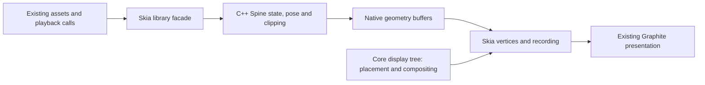

# Native Spine backend assessment

Date: 2026-10-11. Status: architecture assessment, **not implemented or benchmarked**.
This assessment used 0.1.2 plus the TypeScript adapter changes shipping in 0.1.3.
Core, the Spine SDKs and the npm Demo are unchanged.

## Decision

A native Spine backend is feasible without changing Core or authored assets.
The useful boundary is animation state, pose evaluation, weighted vertices,
clipping and native geometry construction together. Moving only bone arithmetic
leaves substantial JS allocation and Skia argument conversion in the frame.

Start with an isolated Spine 4.2 proof of concept inside `@kurot/skia`, using the
existing Release test host. Keep the current JS adapter available for all existing
APIs and all four Spine versions. A native backend preserving common playback
methods is a moderate-to-large addition; transparently reproducing the entire
mutable JS runtime API is a considerably larger task.

120 FPS is a reasonable experiment, **not an established outcome**. The target is
8.33 ms per displayed frame, including the rest of the game. There are three gates:
native computation/geometry transport, API parity, and actual 120 Hz scheduling.
The Android Skia linkage issue below must be resolved before committing to a
complete native rendering implementation.

## Evidence from this checkout

Inspected versions: Core 2.5.3, UI 3.5.0, RN 0.86.3, React Native Skia 3.3.0,
`@kurot/spine-4.2` 0.2.1 with `@esotericsoftware/spine-core` 4.2.120.
Spine 4.0/4.1 use adapter 0.2.1; 4.3 uses 0.3.1.

The [existing optimization](native-spine-optimization.md) measures the current
JS runtime through native GPU rendering. The [raw records](native-benchmarks-2026-10-11.json)
retain source fingerprint `4d9e333ae1e4b23c1b8c2d1ed1269adeb39388c59fbc204e0f5c1d2c52435d29`.
This assessment changes no measured source or recorded results.

| 20 Spineboy, different phases | Update p95 ms | Recording p95 ms | GPU-wait p95 ms | Total p95 ms |
| --- | ---: | ---: | ---: | ---: |
| iOS 26.5 simulator | 7.991 | 7.032 | 3.328 | 16.954 |
| iOS 18.2 simulator | 7.821 | 6.689 | 3.338 | 16.905 |
| Android API 36, software Vulkan | 9.300 | 10.177 | 4.152 | 23.217 |

Update includes animation state, bone/constraint evaluation, attachment vertices
and writes into Core Mesh arrays. Recording includes geometry preparation,
Skia argument conversion and canvas commands. Neither column isolates one
algorithm. Component percentiles are independent; do not sum them to derive a
total percentile or subtract one to predict a native result.

These are offscreen 720×1280 measurements on an M1 Max Mac, with synchronous GPU
completion, 30 warm-up and 120 measured frames, advancing at 60 Hz. They are not
presented frame rates. Android uses CPU `llvmpipe`; the simulated iPhone models
do not provide those phones' processors or refresh-rate behavior. Synchronized
actors benefit from exact geometry sharing and are a weaker acceptance fixture.

| Inspected module | Relevant current behavior |
| --- | --- |
| Spine `SkeletonRenderer` | JS AnimationState update/apply, world transforms, then one SlotRenderer update per draw-order slot |
| Spine `SlotRenderer` | Weighted/clipped vertices, per-frame JS positions/UV/index copies and Core Mesh invalidation |
| Spine `SkeletonAnimation` / `Track` | Public mutable runtime objects; JS queue, segments, events, promises and synchronous `update(0)` |
| `src/kurot/rendering/NativeMeshRenderer.ts` | Ordered batches and immutable geometry sharing; ordinary JS Mesh input |
| Skia `cpp/api/JsiSkVertices.h` | Reads JS point arrays element by element, builds native vectors, then copies to SkVertices |
| `src/kurot/view/KurotView.tsx` / Core `SystemTicker` | View selects 60 FPS; Core throttling caps its interval calculation at 60 |

## Native runtime and rendering boundary

Use the official version-matched `spine-cpp` runtime. It accepts the existing
JSON/binary skeletons and atlas data through an engine texture loader; setup data
can be shared while instances retain independent state. This is CPU pose/skinning
work, not automatic GPU skinning. See the [official C++ integration guide](https://en.esotericsoftware.com/spine-cpp).
That guide currently describes 4.3; use the actual 4.2 sources for this prototype.

The inspected 4.2 upstream commit is
`e7dc1435fa4a0083ab431f1b28e083c14a1f5c68`, containing 67 runtime `.cpp` files and
91 headers under `spine-cpp/spine-cpp`. It already has a renderer that produces
ordered position/UV/color/index commands, including weighted vertices, clipping
and compatible texture/blend batches. Reuse it as the starting point rather than
porting that math from TS. Its allocator-backed command memory must be consumed
or copied before the next render call. See the pinned [renderer header](https://github.com/EsotericSoftware/spine-runtimes/blob/e7dc1435fa4a0083ab431f1b28e083c14a1f5c68/spine-cpp/spine-cpp/include/spine/SkeletonRenderer.h)
and [implementation](https://github.com/EsotericSoftware/spine-runtimes/blob/e7dc1435fa4a0083ab431f1b28e083c14a1f5c68/spine-cpp/spine-cpp/src/spine/SkeletonRenderer.cpp).
This is an inspection pin, not a claim of parity with TS 4.2.120.

Keep resource resolution, image decoding, UI and display-tree ownership in their
current layers. Bind atlas pages to the already loaded Skia images; do not create
a second texture loader/GPU context. Each actor retains its own animation state.
The hot path should transport handles, commands and small event records, without
walking every vertex in JS. SkVertices still needs owned immutable geometry;
removing JS copies does not establish zero-copy GPU upload.

### Skia interoperability is the first gate

The installed Skia 3.3.0 uses JSI **NativeState-backed objects**, not the older
HostObject representation. Its C++ wrappers expose access to the current canvas
and image, but these are version-bound internals. A recording canvas is invalid
after `finishRecording()`; never retain its pointer for later drawing.

Android publishes an `rnskia` Prefab module. However, inspection with NDK
`llvm-nm` of the existing unstripped Release `librnskia.so` finds
`SkVertices::MakeCopy`, `SkVertices::Builder` constructors and
`SkCanvas::drawVertices` as **local symbols**, absent from the dynamic exports.
Wrapper symbols/RTTI are exported, which does not make the underlying factories
linkable. This is based on the recorded APK build, not a hypothetical limitation.
On iOS the pod vendors Skia frameworks; dependent-pod linkage still needs a build
probe. Including private headers alone is insufficient evidence on either platform.

Two practical bridge candidates are:

1. A narrow packed-buffer vertices binding compiled **inside the existing RN
   Skia module**. The Spine module owns native Float32/uint16 buffers; JS passes
   buffer wrappers once per batch; the Skia binding builds its own SkVertices
   without per-point JS conversion. The current public canvas drawing API can
   remain in use. This is the preferred small interop experiment.
2. A native draw extension compiled with RN Skia, receiving an immutable Spine
   frame handle and drawing through the current canvas. It eliminates more calls
   but adds stronger coupling and ownership/threading responsibilities.

Both require proving an extension mechanism or maintaining a narrow RN Skia
patch/fork if no supported mechanism exists. The current package has neither.
The patch, if needed, belongs to the private test host first; a published library
cannot assume that a consumer's Skia installation was patched. An upstream
packed-buffer API would reduce that maintenance cost. Do not hide a second
statically linked Skia/Dawn copy in the new module to bypass the export problem.

Returning vertices to ordinary JS arrays is a useful diagnostic/control path,
but retains the conversion bottleneck. If private Skia interop requires a broad
fork, stop and compare that cost against the measured benefit before proceeding.

## Preserving resources and API

**Authored resources:** keep `resource.json`, `.atlas`, `.skel`/`.json` and page
images unchanged. The generator already bundles atlas dependencies and binary
data. Native parsing can consume those same loaded bytes. Preserve atlas-relative
paths, parser scale, PMA, rotation, sampling and image lifetime.

**Constructor input:** `new SkeletonAnimation(data)` currently accepts a parsed
JS SkeletonData, not an asset filename. Library-side loader/parser instrumentation
could associate original bytes, atlas pages and parser options through a WeakMap.
That association is new work; arbitrary programmatically created or subsequently
mutated SkeletonData cannot be reconstructed safely from the original file.
Such data needs JS compatibility mode unless an exact conversion is implemented.
Duplicate parsing at load time may be acceptable initially; mirroring every pose
back to JS every frame defeats the main benefit.

| Existing surface | Native compatibility scope |
| --- | --- |
| `play`, segments, loops, stop, timeScale, mix, named skins | Small control facade, but exact Kurot Track behavior must be reproduced |
| Events and `wait*` promises | Preserve order, interruption, queue advancement and reentrant playback; cannot simply emit all events one frame later |
| Sprite transforms, stage lifecycle, alpha/tint, masks, filters, caches | Reuse host Core objects; add a library-owned native content renderer and bounds/dirty propagation |
| `skeleton.findBone(...)`, `state`, `stateData`, `trackEntry` | Actual mutable JS runtime objects today; native handles alone do not preserve nested writes, identity or prototypes |
| `renderer.slotRenderers`, `findSlotRenderer`, custom children/slot effects | Real Core Mesh instances today; opaque whole-actor drawing cannot transparently replace their observable behavior |
| Custom data/attachments/timelines, raw runtime classes and monkey patches | Keep existing JS behavior; broad native proxy support is a separate compatibility project |

Maintaining existing APIs for applications is feasible by retaining the full JS
path. **Accelerating every existing API use transparently is not established.**
The prototype should select native mode explicitly, before actor creation, for a
known capability set. It must report the actual backend used. Native-only test
results must not silently include JS fallback actors.

An optional version-validated native facade could later preserve the usual
`@kurot/spine-4.2` imports and playback signatures through the library resolver.
Do not globally replace those exports until identity, deep imports, constructor
inputs and raw-object access are tested. Keeping the JS mode available adds no
required resource/API migration; the accelerated mode needs its own documented
eligibility contract. If the requirement is full raw-object equivalence *while
remaining native*, budget for the larger proxy/mutation bridge, not this first cut.

Runtime fallback after a getter/write is not a free solution: it needs exact
transfer of tracks, mixing history, constraints, attachment/deform state, events
and the current pose. No such conversion exists. Until it is proven, choose the
compatible backend at creation rather than silently restarting an animation.

Match existing color/tint quantization and compositing, including current adapter
limits for multiply/screen slots and texture wrap hints. C++ render commands with
per-vertex/dark colors do not automatically preserve the existing paint behavior.

The library can recognize its native content through a registry and a Core Sprite
subclass with measured bounds/hit behavior. No new Core render tag or platform
interface is necessary. Existing outer compositing can remain shared, but native
content must invalidate cached ancestors and participate in RenderTexture/pixel
hit tests; skipping the Mesh children does not automatically preserve those paths.

## 120 Hz scheduling and ownership

Core 2.5.3 `SystemTicker.setFrameRate()` uses `Math.min(value, 60)` for its interval
calculation. Its count branch also assumes 60 Hz callbacks; at higher callback
rates it can render every callback rather than enforce a literal 60 FPS cap.
Thus neither this clamp nor `stage.frameRate = 120` proves actual frame cadence.
An isolated Node probe confirms 60 callbacks produce 60 renders at a 120 target,
while 120 callbacks produce 120 renders even at a 60 target. This simulates
one second of callbacks; it does not measure RN presentation.
A Skia-owned native ticker port/resolver mapping can keep
Core sources and Web unchanged. It must preserve one shared ticker, `callLater`,
invalidation, player/ENTER_FRAME order, pause/resume and UI/Tween semantics, with
60 remaining the default and 120 explicitly selected.

Initially execute C++ synchronously on the calling JS thread. Native computation
does not require a new thread. This keeps control/event order tractable and tests
the gain from compilation and allocation removal first. Batch actors only where
it preserves observable update/event ordering. Later worker/UI-runtime execution
needs separate synchronization; never access a JS runtime from an arbitrary worker
or record into another thread's Graphite canvas.

Use immutable frame snapshots and explicit owners for shared data, atlas images,
actor state and recorded geometry. Stage removal pauses updates but may permit
reattachment; it is not necessarily final destruction. Define final disposal,
pending-load cancellation, app background and runtime teardown separately. Native
allocator pointers must not outlive their producer; typed buffer views must not
outlive the owner or be overwritten while still consumed by Skia.

The test host already has `CADisableMinimumFrameDurationOnPhone=true`. Real 120 Hz
still needs display-linked scheduling and presentation measurements; that key
does not guarantee a rate. Apple documents rate preferences and system-dependent
cadence in its [ProMotion guide](https://developer.apple.com/documentation/quartzcore/optimizing-iphone-and-ipad-apps-to-support-promotion-displays).
120 submissions or repeated 60 Hz pictures are not 120 animation frames. A 60 Hz
display can test CPU headroom, but cannot validate 120 FPS presentation.

## Modification size and packaging

Keep this inside `@kurot/skia` initially. Suggested responsibilities are TS facade/
resources under `src/kurot/spine`, C++ engine/interop under `native/spine`, pinned
upstream sources/notices under `native/vendor`, and normal iOS/Android module
registration/build files. These paths and interfaces are proposals, not exports.

| Area | Expected changes |
| --- | --- |
| Native build/bootstrap | C++ module, JSI installation or C++ TurboModule bootstrap, podspec, Android Gradle/CMake/autolinking, npm source files |
| Spine native engine | Asset/instance ownership, command/event bridge, constraints, geometry snapshots and runtime-version dispatch |
| Skia interop | Packed native geometry binding or draw extension; exact Skia ABI/link validation on both platforms |
| TS/display integration | Version-bound facade, asset provenance, native draw registry, bounds/hits/cache invalidation and JS compatibility mode |
| Scheduling | Native ticker adaptation, 60/120 configuration, display cadence and lifecycle tests |
| Tests/release | Headless parity, GPU pixels, event/API regressions, memory/teardown, package installation and performance traces |

This means several new modules and two native build integrations, not a few edits
to `NativeMeshRenderer`. Rough planning estimates for one engineer familiar with
this repo and RN C++, assuming a narrow Skia bridge can be built:

| Increment | Estimate | Deliverable |
| --- | --- | --- |
| Interop + Spine 4.2 performance prototype | 3–7 person-days | Both Release hosts load the same Spineboy and transport geometry without per-vertex JS traversal |
| Common 4.2 playback/scene integration | A further 2–4 weeks | Facade, Track/event parity, resources, bounds/caches and lifecycle |
| Release hardening and 120 scheduling | A further 1–3 weeks | Regression/packaging/teardown and measured cadence |

These are estimates, not delivery promises; a substantial RN Skia fork invalidates
them. Full raw-JS API parity and native 4.0–4.3 are additional projects requiring
an API inventory and measured demand before a credible schedule. 4.3 already has
different pose/draw-order APIs. Separate C++ versions also need isolated symbols
and larger binary/package tests; do not feed every asset version to one runtime.

New native code requires rebuilding the Expo development/Release app; a Metro
reload cannot install it. Generator watch behavior and Node-only usage remain
unchanged. Runtime peer/ABI checks must remain version-bound; no Core/UI/Spine SDK
bump or higher Core minimum follows from this design. The official [RN 0.86 C++
module guide](https://reactnative.dev/docs/0.86/the-new-architecture/pure-cxx-modules)
provides the module/Codegen/registration starting point, not a Skia interop contract.
Vendored Spine code retains its [upstream license and copyright notices](https://github.com/EsotericSoftware/spine-runtimes/blob/e7dc1435fa4a0083ab431f1b28e083c14a1f5c68/LICENSE),
with pinned commits/hashes and an update process separate from our glue code.

## Prototype acceptance and stop conditions

1. Prove iOS and Android native module linkage against the installed Skia, using
   the existing image/canvas. Establish the bridge/patch footprint first. Reject
   a second GPU context or an implicit second Skia/Dawn implementation.
2. Compare C++ and JS 4.2 at identical timestamps: regions, weighted/deformed
   meshes, draw order, multi-page/rotated/PMA atlases, clipping and constraints.
   Include timeScale, mixes, segments, interrupts and reentrant events. Current
   JS update does not call `skeleton.update(dt)` before the physics world-transform
   step; audit physics parity explicitly rather than adding it silently.
3. Retain current 60 Hz fixtures and hashes. Add separate 120 Hz CPU/offscreen
   fixtures advancing by `1000/120`, with 1/5/20 independent actors, synchronized
   and staggered phases, and mixed battle UI/effects. Profile native update,
   geometry construction, JSI transport, recording and GPU work independently.
4. Repeat long enough to expose allocator/GC tails; report p50/p95/p99, >8.33 ms
   percentages, memory and first-load cost. A useful initial engineering target
   is ≤5 ms p95 total for the isolated 20-actor offscreen scene, leaving some game
   budget. This is a proposed gate, not a prediction; real presentation remains
   a separate acceptance step.
5. Re-run the complete native suite, including the unchanged 48 nine-slice GPU
   cases and all four JS Spine versions. Add native bounds/hits, cache/RenderTexture,
   transforms, clips, alpha/blends, custom slot compatibility, remove/readd and
   repeated destruction tests. Keep the existing pixel tolerance; investigate
   float/color differences rather than weakening references to obtain a pass.

If native computation is faster but geometry transport still dominates, the
bridge has failed its purpose. If only synchronized actors pass, independent
battle characters have not passed. If full API compatibility requires evaluating
both JS and C++ every frame, measure that cost before adopting the design.

The user selected simulator-only testing for this round. A successful prototype
can establish headroom and scope there. Sustained 120 FPS requires a later,
explicitly selected 120 Hz physical-device Release run with frame-presentation,
CPU/GPU/memory and thermal evidence. No simulation result certifies that outcome.
